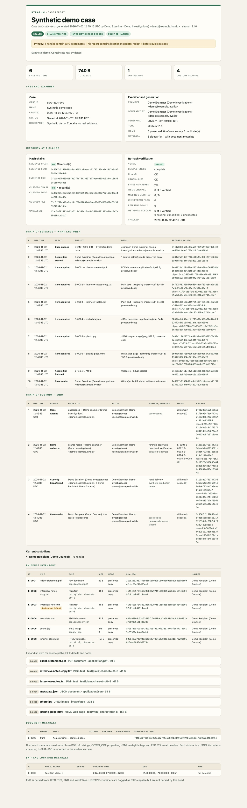

# Stratum

**Case evidence and chain-of-custody workspaces for investigators.**

[](#build-from-source)
[](LICENSE)
[](#design)

Stratum turns a directory of collected material — web pages, PDFs, photos,
documents, archives, databases, mail — into a defensible case workspace. It
preserves read-only copies, records SHA-256 hashes and content types, extracts
EXIF where it can, and writes two independent hash-chained ledgers:

- **Chain of evidence** — *what* was collected and *when*.
- **Chain of custody** — *who* collected, held, transferred, returned, sealed
  or verified it.

It is designed as a sibling to [Subsoil](https://github.com/subsll/subsoil):
the same single-binary, no-runtime, hash-chained evidence philosophy, applied
to case files and physical/digital custody instead of DNS reconnaissance. The
ledger format is compatible with Subsoil's verifier.

```text
$ stratum init "Smith v Acme" --examiner "Jane Doe" --org "Doe Investigations"
[+] case workspace created
    case       CASE-20261102-46EC91 — Smith v Acme
    path       /cases/CASE-20261102-46EC91-smith-v-acme
    examiner   Jane Doe (Doe Investigations)
    evidence   .../evidence.jsonl
    custody    .../custody.jsonl

$ stratum add ~/collected/web ~/collected/docs --origin "client delivery 2026-11-02"
[+] E-0001     1.4 MiB  pricing-page.html
[+] E-0002    86.2 KiB  contract.pdf
[+] E-0003     4.1 MiB  IMG_0421.jpg
...
[+] acquisition complete
    items      12 (63.4 MiB), 1 duplicate(s)
    evidence   20 record(s), root 7f3c...
    custody    collection recorded

$ stratum custody transfer --to "Bob Smith" --to-org "Acme Legal" \
    --purpose "production to counsel" --method "hand delivery"
[+] custody transferred recorded
    from        Jane Doe (Doe Investigations)
    to          Bob Smith (Acme Legal)
    items       all items (12)
    record      #3 5dc1...
    custody root 5dc1...

$ stratum seal --note "evidence set closed for production"
$ stratum report
$ stratum verify
verdict     PASSED (complete)
```

> **Authorised use only.** Stratum records evidence; it does not decide legal
> admissibility. Use it only for material you are authorised to handle, and
> follow the law and professional standards of your jurisdiction.



---

## Why this exists

A private investigator or forensic examiner often receives a folder rather than
a disk image: a web page saved as HTML, a PDF from a client, a phone photo, a
spreadsheet, a mail export. The questions are always the same:

1. **What is in the folder?**
2. **What are the exact bytes and when were they collected?**
3. **Who handled them, and when?**
4. **Can someone else verify that later?**

Stratum answers those four questions in one portable binary and one case
directory. It is deliberately conservative:

- Sources are opened **read-only** and never written.
- Preserved copies are written to a temporary file, fsynced, **read back and
  SHA-256 verified**, then renamed into place and made read-only.
- The source size and mtime are re-checked after reading; a change is recorded,
  never hidden.
- Symlinks are recorded as skipped, not followed.
- The ledgers are append-only and hash-chained. Reports never modify them.
- Unknown or ambiguous content is reported with a confidence level, not guessed
  silently.

---

## Highlights

- **Case workspaces** — `init`, registry, per-case lock, seal/unseal.
- **Verified acquisition** — streaming SHA-256, copy read-back, fsync,
  timestamp preservation, read-only copies, duplicate detection.
- **Content-first file identification** — PDF, Office/OOXML, OpenDocument,
  EPUB, ZIP/7z/RAR, images, HEIF/AVIF, raw formats, HTML/MHTML/WARC/HAR, EML,
  PST/OST, SQLite, EVTX, PE/ELF, media containers and more.
- **EXIF + document metadata sidecars** — camera make/model, serial, lens,
  original timestamp, orientation, dimensions and GPS for JPEG/TIFF/PNG/WebP,
  plus PDF/Office/ODF/HTML/email metadata. Each item gets a hashed JSON sidecar.
- **Two tamper-evident ledgers** — evidence and custody, each its own SHA-256
  chain; every custody record anchors an evidence root.
- **Sealing** — blocks new acquisitions, allows documented transfers,
  metadata extraction, verification and reports; `unseal` records the reason in
  both ledgers.
- **Reports** — plain text, Markdown, standalone print-friendly HTML, complete
  JSON audit copy and CSV exports, plus `MANIFEST.json` and `SHA256SUMS`.
- **Verification** — structural chain checks, cross-link checks, re-hashing of
  every preserved item, metadata-sidecar hash checks, and missing/modified/
  unexpected file detection.
- **One static binary** — no runtime, no database, no external services, no
  third-party Go dependencies.

---

## Install

### Install with Go (recommended)

Requires Go 1.25 or newer. This installs the latest tagged release:

```sh
go install github.com/subsll/stratum/cmd/stratum@latest
```

`go install` writes the binary to Go's bin directory. If `stratum` is not found
afterwards, add that directory to your `PATH`:

```sh
export PATH="$(go env GOPATH)/bin:$PATH"
```

Verify the installation:

```sh
stratum version
```

Run the same `go install github.com/subsll/stratum/cmd/stratum@latest` command
again at any time to upgrade to the latest release.

### Prebuilt binaries

`make linux` creates static Linux binaries for amd64, arm64, armv7 and 386.
`make checksums` writes `dist/SHA256SUMS`. Download, verify and run:

```sh
sha256sum -c SHA256SUMS
chmod +x stratum_<version>_linux_amd64
./stratum_<version>_linux_amd64 version
```

### Build from source

Requires Go 1.25 or newer.

```sh
git clone https://github.com/subsll/stratum.git
cd stratum
go test ./...
make build            # dist/stratum
./dist/stratum version
```

---

## Quick start

```sh
stratum                                      # welcome screen

# 1. Create a case. The examiner is the first custodian.
stratum init "Smith v Acme" \
  --examiner "Jane Doe" --org "Doe Investigations" --email jane@example.com

# 2. Enter the workspace printed by init, or pass --workspace.
cd CASE-*/
stratum add ../collected/web ../collected/docs \
  --origin "client delivery 2026-11-02"

# 3. Review what was acquired.
stratum list --hash
stratum show E-0003

# 4. Document a handover (for all items or selected items).
stratum custody transfer --to "Bob Smith" --to-org "Acme Legal" \
  --method "hand delivery" --purpose "production to counsel"
stratum custody list

# 5. Close the evidence set.
stratum seal --note "evidence set closed for production"

# 6. Produce reports (all formats, or one).
stratum report
stratum report -f html
stratum report -f md,json --out ./delivery

# 7. Re-verify at any time.
stratum verify
stratum verify --record --examiner "Jane Doe"   # append a verification event
```

Use `-w`/`--workspace` from anywhere:

```sh
stratum list -w /cases/CASE-20261102-46EC91-smith-v-acme
```

---

## Workflow for a case

### 1. Create the workplace

```sh
stratum init "Smith v Acme" --examiner "Jane Doe" --org "Doe Investigations"
```

This creates:

```text
CASE-20261102-46EC91-smith-v-acme/
├── case.json          # human-readable marker (the ledger is authoritative)
├── evidence.jsonl     # chain of evidence: what and when
├── custody.jsonl      # chain of custody: who
├── items/             # preserved, read-only copies
├── metadata/          # hashed EXIF/document metadata sidecars
├── reports/           # generated reports, one directory per run
├── README.md          # handling rules and command reminders
└── .stratum.lock      # transient; only while a mutation is running
```

The first records are `case_created` (evidence) and `custody_open` (custody).
The examiner named here is the starting custodian. The case is registered in
`~/.stratum/workspaces.json` (or `$STRATUM_HOME/workspaces.json`) unless
`--no-register` is used.

### 2. Acquire source material

```sh
stratum add ./collected --origin "seized from client laptop, 2026-11-02"
```

Directories are walked recursively. For each regular file Stratum:

1. opens the source read-only;
2. streams the bytes once into a temporary file while hashing them;
3. fsyncs and closes the temporary copy;
4. reads the copy back and compares its SHA-256 with the source bytes;
5. preserves the source mtime, sets the copy read-only (`0444`);
6. renames it to `items/E-0001__original-name.ext`;
7. detects the content type and extracts EXIF plus document metadata;
8. writes `metadata/E-0001__original-name.ext.json` and hashes it;
9. appends an `item_acquired` record carrying both the item hash and the
   sidecar path/SHA-256 to the chain of evidence;
10. appends a `custody_collect` record to the chain of custody.

By default files are **preserved** in the workspace. If a file cannot be
copied — for example a very large video that must stay on source media — use:

```sh
stratum add ./huge-video.mp4 --reference \
  --note "hash only; file remains on source media"
```

Reference-only items are marked as such in reports; verification is partial
because only the original source can be re-hashed.

Useful acquisition options:

```sh
stratum add ./collected --exclude "*.tmp" --exclude ".DS_Store"
stratum add ./collected --skip-hidden
stratum add ./collected --origin "https://example.test/pricing" --note "captured page"
stratum add ./collected -v
```

### 3. Review

```sh
stratum list
stratum list --hash
stratum show E-0001
```

`show` re-hashes the preserved copy right then and prints the current
custodian, content type, detection confidence, extension-match warning, EXIF
details and the item's custody history.

### 4. Transfer custody

All items:

```sh
stratum custody transfer \
  --to "Bob Smith" --to-org "Acme Legal" --to-email bob@example.com \
  --method "hand delivery" \
  --purpose "production to counsel" \
  --location "Acme Legal, Reception" \
  --note "sealed box, seal intact"
```

Selected items:

```sh
stratum custody transfer --to "Evidence Store" \
  --item E-0002 --item E-0007 --method courier
```

Return:

```sh
stratum custody return --to "Jane Doe" --item E-0002 --method "hand delivery"
```

The current custodian is derived from the custody ledger. If selected items
have different custodians, Stratum requires separate transfers (or an explicit
`--from` matching the current holder) rather than inventing a handover.

### 5. Seal

```sh
stratum seal --note "evidence set closed for production"
```

Sealing appends a seal record to both ledgers and blocks further acquisition.
Transfers, metadata extraction, verification and reports still work. If new
material arrives, break the seal explicitly:

```sh
stratum unseal --reason "late production received from client 2026-11-05"
stratum add ./late-production --origin "client email 2026-11-05"
```

The reason is written to both ledgers. There is no silent unseal.

### 6. Report

```sh
stratum report                              # text, md, html, json, csv
stratum report -f html                      # one format
stratum report -f md,json --out ./delivery  # chosen formats and directory
stratum report --no-rehash                  # faster, marked partial
```

Every report directory contains:

| File | Purpose |
| --- | --- |
| `report.txt` | plain-text case report |
| `report.md` | Markdown report for editing/delivery |
| `report.html` | standalone, print-friendly HTML (no external assets) |
| `report.json` | complete machine-readable audit copy, including raw records |
| `items.csv` | evidence inventory, including metadata sidecar hashes |
| `metadata.csv` | EXIF and document metadata per item |
| `evidence.csv` | chain-of-evidence chronology |
| `custody.csv` | chain-of-custody chronology |
| `MANIFEST.json` | roots, verification summary and hashes of report files |
| `SHA256SUMS` | standard checksums covering every file in the directory |

Reports are derivative artefacts. Generating one never appends to either
ledger.

### 7. Verify

```sh
stratum verify
stratum verify --no-rehash          # chains and cross-links only
stratum verify --record             # append a verification event
stratum verify path/to/evidence.jsonl
```

Verification checks:

- each evidence record's canonical hash and previous-record link;
- the same for the custody ledger;
- every custody record's evidence-root anchor;
- every item has a custody collection event and a current custodian;
- every preserved item still exists, is a regular file, has the recorded size
  and hashes to the recorded SHA-256;
- every recorded metadata sidecar still exists, is a regular file, has the
  recorded size/SHA-256, is valid JSON, and is bound to the item's hash;
- no unrecorded files exist in `items/` or `metadata/` (OS junk such as
  `.DS_Store` is warned about, not silently ignored);
- reference-only items are reported as partial;
- case.json drift is warned about but the chain remains authoritative.

Exit status is `0` for a passing check and `1` for a failure. A partial (for
example reference-only) result still exits `0`; the report says `partial`.

---

## Commands

| Command | Description |
| --- | --- |
| `stratum` | welcome screen |
| `stratum init <name>` | create a case workspace |
| `stratum add <path>...` | acquire files/directories |
| `stratum list` (alias `ls`) | list items and holders |
| `stratum show <item-id>` | inspect one item, its metadata and custody history |
| `stratum extract [--all]` | add/refresh metadata sidecars for existing items |
| `stratum custody [list]` | show the custody ledger and current holders |
| `stratum custody transfer --to <name>` | record a handover |
| `stratum custody return --to <name>` | record a return |
| `stratum seal` / `stratum unseal` | close / reopen the evidence set |
| `stratum verify [ledger.jsonl]` | verify chains, cross-links and item bytes |
| `stratum report` | write reports |
| `stratum workspaces` (alias `cases`) | list registered workspaces |
| `stratum version` / `stratum help [topic]` | build info / help |

Run `stratum help <command>` for all flags and examples.

Common flags:

- `-w, --workspace PATH` — case directory; otherwise the nearest parent case
  or `$STRATUM_WORKSPACE`.
- `--examiner`, `--org`, `--email` — the person recording the action; defaults
  come from `STRATUM_EXAMINER`, `STRATUM_ORG`, `STRATUM_EMAIL` and the case
  examiner.
- `--force-lock` — break a stale workspace lock after confirming no other
  Stratum process is running.
- `--json` — machine-readable output for `list`, `show`, `custody list`,
  `verify` and `workspaces`.

Environment:

| Variable | Meaning |
| --- | --- |
| `STRATUM_HOME` | registry directory (default `~/.stratum`) |
| `STRATUM_WORKSPACE` | default case directory |
| `STRATUM_EXAMINER`, `STRATUM_ORG`, `STRATUM_EMAIL` | default actor |
| `NO_COLOR` | disable colour in the welcome screen |

---

## File-type detection

Stratum identifies content first, using magic bytes and container structure,
and compares the result with the extension. Detection is descriptive evidence,
not a guarantee of safety or validity. Confidence is `high`, `medium` or
`low`; an unknown extension is not treated as a mismatch.

| Family | Examples |
| --- | --- |
| Documents | PDF, RTF, PostScript, OOXML (DOCX/XLSX/PPTX), ODF (ODT/ODS/ODP), EPUB, OLE (legacy DOC/XLS/PPT/MSG) |
| Images | JPEG, PNG, GIF, BMP, TIFF, WebP, HEIC/HEIF, AVIF, PSD, JXL, SVG, TIFF-based raw (DNG/CR2/NEF/ARW) |
| Archives | ZIP, 7z, RAR, gzip, bzip2, xz, tar, ISO, EnCase E01 |
| Web captures | HTML, MHTML, WARC, HAR, JSON, XML |
| Email | EML (RFC 822), Outlook MSG (OLE), PST/OST |
| Data | SQLite, EVTX, plain text, CSV/TSV, Markdown |
| Media | MP4/MOV/3GP, AVI, MKV/WebM, FLV, MP3, WAV, FLAC, OGG, M4A |
| Executables | PE, ELF, scripts with shebang |
| Other | binary/unknown, empty |

Limitations: the detector reads the first 64 KiB plus ZIP central directories
and image container metadata. It does not execute, render or fully validate
files. UTF-16 text, obscure formats and deliberately malformed containers may
be classified as binary or unknown. Extension mismatch is a warning, not proof
of wrongdoing.

---

## EXIF and metadata

EXIF is parsed from:

- **JPEG** (APP1 `Exif` segments),
- **TIFF** (including TIFF-based raw formats),
- **PNG** (`eXIf` chunks),
- **WebP** (`EXIF` chunks).

Extracted fields include make, model, body serial, lens, software, artist,
copyright, orientation, dimensions, original/digitised timestamps, offset time
and GPS latitude/longitude/altitude/timestamp. XMP presence is flagged for JPEG,
PNG, WebP and TIFF application notes, but XMP properties are not interpreted.

Document metadata is extracted from:

- **PDF** — Info-dictionary strings (title, author, subject, keywords, creator,
  producer, creation/modification dates) and XMP presence;
- **OOXML** (DOCX/XLSX/PPTX) — `docProps/core.xml` and `docProps/app.xml`;
- **ODF** (ODT/ODS/ODP) — `meta.xml`, including document statistics;
- **HTML** — `<title>` and meta tags (author, description, keywords, generator,
  dates, OpenGraph/Twitter fields);
- **EML** — RFC 822 headers (from, to, subject, date, message-id and more).

Every item gets a JSON sidecar under `metadata/` containing the EXIF and
document metadata, bound to the item's SHA-256. The sidecar's own SHA-256 is
recorded in the evidence chain. Use `stratum extract --all` to add sidecars to
items acquired by an older version, or `stratum extract E-0001 --force` to
replace one.

HEIF/HEIC and AVIF are detected and marked **EXIF-capable**, but this build does
not extract HEIF EXIF items. Use a dedicated metadata tool for those files and
attach the result as a note if it matters to the case.

GPS coordinates and altitude are stored in the ledger as decimal strings rather
than floats. This keeps every ledger number an integer, so an independent
verifier in another language can reproduce canonical JSON bytes exactly.

GPS data is sensitive. Reports warn when GPS is present. Redact it before public
release or disclosure to people who do not need it.

---

## Reports

The HTML report is a single offline file with embedded CSS, designed for
screen and print. It includes:

- case and examiner details;
- integrity status: sealed/open, chain status, verification status;
- summary cards and type breakdown;
- the full chain of evidence (what and when);
- the full chain of custody (who), including each record's evidence anchor;
- an evidence inventory with hashes, holders, modes and extension warnings;
- per-item details, EXIF/GPS metadata and document metadata;
- metadata-sidecar hashes and verification status;
- acquisition issues and warnings;
- integrity detail, missing/modified/unexpected files and metadata sidecars;
- method and limitations;
- an attestation block with roots and generation details.

The JSON report is the complete audit copy: raw evidence and custody records,
items, verification result, warnings and issues. The CSV exports are intended
for spreadsheets and downstream review.

---

## Integrity model

Each ledger is append-only JSONL. A record's SHA-256 covers its own fields and
the previous record's hash. The **root hash** is the last record's hash.
Verification recomputes every record and every link. Canonical encoding is
strict: whitespace, key-order or duplicate-key changes are detected even if a
naive JSON parser would accept them.

The custody ledger is separate. Every custody record includes:

- `evidence_root` — the evidence-chain root at the moment of the action;
- `items` — explicit item IDs or `*` (all items acquired before the event);
- `from`, `to`, `actor`, method, purpose, location, note and item count.

This gives a cross-anchor: a custody event can only be fabricated if the
attacker recomputes both ledgers consistently, and even then the externally
anchored roots expose the rewrite.

**What a hash chain proves:** the ledgers existed in this exact form when you
received them; records were not edited, removed or re-ordered afterwards.

**What it does not prove:** that the original source was truthful, that the
machine was uncompromised, that the examiner followed the law, or that a
self-contained ledger was not completely rewritten. A hash chain is
**tamper-evident, not tamper-proof**. Anchor the roots outside the workspace:

```sh
stratum report -f text
gpg --detach-sign path/to/report/SHA256SUMS
# or send the root hashes to the client / timestamp authority
```

The report's `MANIFEST.json` and `SHA256SUMS` make the report directory
independently checkable. Keep the original ledgers even after generating
reports.

---

## Best practices and limitations

**Do**

- Work from a copy or a read-only mount/write blocker when the source is
  original media.
- Record the operator, organisation, purpose and provenance (`--origin`) at
  the time of acquisition.
- Keep the case directory on trusted, backed-up storage.
- Seal when the evidence set is complete; document any unseal.
- Verify with re-hashing before relying on a report; record the verification.
- Review metadata sidecars and document metadata; run `stratum extract --all`
  on cases created before metadata sidecars were introduced.
- Anchor roots outside the workspace (signed checksums, email, timestamp).
- Review extension-mismatch, source-instability and reference-only warnings.
- Redact sensitive paths/GPS before disclosure.

**Know the limits**

- Stratum is a **file-level** acquisition tool, not a disk imager. It does not
  capture deleted data, unallocated space, slack space, alternate data streams,
  xattrs/ACLs, resource forks or a full partition image.
- It preserves mtime on the copy but does not preserve/record all timestamps
  (birth/ctime/atime), ownership, ACLs or extended attributes. Reading a source
  can update its access time.
- Preserved copies and metadata sidecars are set read-only, but a user with
  directory write access can still delete or replace them. Verification is how
  you detect that.
- Metadata sidecars are derived from the item at extraction time. A sidecar
  that no longer matches the item record is treated as modified; do not edit
  sidecars by hand.
- Reference-only items have no preserved copy; only the original source can be re-hashed.
- File-type detection, EXIF parsing and document metadata extraction are
  best-effort, bounded and non-executing. PDF Info strings and HTML meta tags
  can be absent, ambiguous or misleading; they are not a substitute for a
  specialist examination.
- A self-contained hash chain can be rewritten by an attacker; external
  anchoring is what makes it useful against that threat.
- Stratum is not legal advice. Admissibility, disclosure, retention and
  privacy obligations depend on your jurisdiction and engagement.

```text
Source files  ──read-only──▶  hash (source bytes)
                                   │
                                   ▼
                         temporary copy + fsync
                                   │
                                   ▼
                         read-back SHA-256 check
                                   │
                                   ▼
                    items/E-nnnn__name (read-only)
                                   │
                    ┌──────────────┴──────────────┐
                    ▼                             ▼
        metadata/E-nnnn__name.json       file SHA-256 + metadata SHA-256
        EXIF + document metadata                  │
                    │                             │
                    └──────────────┬──────────────┘
                                   │
              ┌────────────────────┴────────────────────┐
              ▼                                         ▼
   evidence.jsonl (what/when)                 custody.jsonl (who)
   record hash ──▶ previous hash              record hash ──▶ previous hash
              │                                         │
              └────────── evidence_root anchor ──────────┘
                                   │
                                   ▼
                         reports + MANIFEST + SHA256SUMS
```

---

## Design

- **No third-party dependencies.** The binary is pure Go standard library.
- **No database.** The case is a directory; the ledgers are JSONL and can be
  read with `jq`, Python or a text editor.
- **Compatible chain format.** Field order and canonical JSON match
  [Subsoil](https://github.com/subsll/subsoil), so Subsoil's verifier can check
  a Stratum ledger structurally (it does not interpret custody semantics).
- **Testability.** CLI commands live in `internal/app`; the chain, acquisition,
  detection, EXIF, workspace, verification and report packages are independently
  tested, including tamper and malformed-input cases.
- **Conservative failure.** A broken chain refuses new appends. A copy that
  fails read-back is not recorded as evidence. A sealed case refuses acquisition.
  A symlinked preserved file is reported as modified rather than followed.

---

## Build and test

```sh
make build          # dist/stratum
make test           # go test ./...
make race           # go test -race ./...
make vet            # go vet ./...
make linux          # static Linux amd64/arm64/armv7/386 binaries
make checksums      # dist/SHA256SUMS
make demo           # synthetic end-to-end demo in a temp directory
```

The test suite covers the hash chain, strict canonical encoding and tamper
detection; file-type detection; EXIF and document metadata parsing (including
malformed input); metadata sidecars; case workspace lifecycle and locking;
verified acquisition; verification; report escaping and checksums; and the full
CLI workflow (init → add → custody → seal → report → verify → unseal →
extract/backfill → tamper detection).

---

## Documentation

- [Evidence and custody format](docs/evidence-format.md)
- [Best practices for investigators](docs/best-practices.md)
- [Security policy](SECURITY.md)
- [Contributing](CONTRIBUTING.md)

---

## License

MIT. See [LICENSE](LICENSE). Subsoil's chain format and CLI conventions are
acknowledged in [NOTICE](NOTICE).
